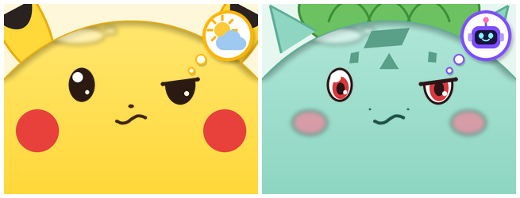

# PokeChan

[English](README.md)

**PokeChan** 是给 [M5Stack StackChan](https://github.com/m5stack/StackChan) 桌面机器人做的社区改版固件。StackChan 原有的功能都保留，另外加了：

- **宝可梦脸盘**：皮卡丘、小火龙、妙蛙种子、杰尼龟、百变怪，用语音就能换（"换成皮卡丘"）。原版的眨眼、说话张嘴、呼吸、待机张望这些动画都保留。
- **招牌特效**：小火龙生气时火尾巴烧得更旺，皮卡丘生气时脸颊放电，杰尼龟耍酷时戴上墨镜。
- **技能图标**：调用工具时，脸会变成思考表情，右上角弹出对应的技能图标（天气、新闻、搜索、Muse、提醒、拍照），像宝可梦发动招式一样。原来嘴边那个经常显示空白的文字气泡去掉了，说话时只有嘴在动。
- **内置 Muse**：把 Muse Gadget SDK 的会话代码移植进固件，可以问你的 [Meta Muse](https://gadgets.muse.ai/) 日程、邮件和记忆，答案在同一轮对话里直接念出来。
- **Mac 端 MCP 工具**：通过 StackChan World App 的 MCP 接入点，接入免费的天气（Open-Meteo）、网页搜索和新闻搜索（DuckDuckGo），在 Mac 上开机自启。


 

> **非官方同人项目。** PokeChan 与任天堂、The Pokémon Company、Game Freak、Creatures、M5Stack、Meta、虾哥小智均无关联，也未获得它们的认可或赞助。Pokémon 及其角色名称和形象是各权利人的商标和版权。宝可梦脸盘是非商业的同人作品，使用或分享前请先阅读 [DISCLAIMER.md](DISCLAIMER.md)。

## 整体结构

```
 "Hi Stack-chan"            ┌──────────────────────────────┐
  语音 ───────────────────▶ │ StackChan（ESP32-S3, CoreS3） │
                            │  小智语音 + 唤醒词             │
                            │  PokeChan 脸盘、技能图标       │
                            │  Muse 桥（WSS 上的 Noise 会话）├──▶ Muse（Meta）：日历、邮件、记忆
                            └──────────────┬───────────────┘
                                           │ MQTT / WebSocket
                                           ▼
                                  xiaozhi.me（免费大模型、语音识别、语音合成）
                                           │ MCP 接入点（WebSocket）
                                           ▼
                            Mac：mcp-server/（天气、网页搜索、新闻搜索）
```

## 仓库结构

本仓库 fork 自 [m5stack/StackChan](https://github.com/m5stack/StackChan)，PokeChan 的改动都在 `pokechan` 分支上：

| 路径 | 内容 |
| --- | --- |
| `firmware/` | 加入 PokeChan 改动的 StackChan 固件（ESP-IDF 5.5.4） |
| `firmware/components/muse_hatch/` | Muse 桥：Muse Gadget SDK 的会话代码，加上和 StackChan 对接的代码 |
| `firmware/components/noise_core/`、`minimp3/` | 来自 Muse Gadget SDK 的库 |
| `firmware/main/stackchan/avatar/skins/pokemon/` | 宝可梦皮肤、特效层、技能图标 |
| `firmware/tools/pokemon_faces/` | 生成所有脸盘、特效和图标素材的脚本 |
| `firmware/tools/muse/muse_token.py` | 把 Muse 设备令牌从官方 Muse 固件转移到 PokeChan |
| `firmware/patches/xiaozhi-esp32.patch` | xiaozhi-esp32 v2.2.4 的补丁（StackChan 原有的，加上异步 MCP 工具） |
| `mcp-server/` | Mac 端 MCP 服务和 launchd 开机自启配置 |
| `docs/pokechan/` | PokeChan 文档（中文） |
| `app/`、`server/`、`remote/` | StackChan 上游的 App、服务端和遥控器，未改动 |

## 快速开始

1. 编译并刷入固件：[docs/pokechan/build-and-flash.md](docs/pokechan/build-and-flash.md)
2. 可选，接入 Muse：[docs/pokechan/muse.md](docs/pokechan/muse.md)
3. 可选，部署 Mac 端工具：[docs/pokechan/mcp-server.md](docs/pokechan/mcp-server.md)
4. 开始对话：[docs/pokechan/skills.md](docs/pokechan/skills.md) 列出了所有工具和对应的说法。

更多文档：
- [功能特性与新增资源](docs/pokechan/features.md)
- [脸盘与素材生成器](docs/pokechan/skins.md)
- [串口调试命令](docs/pokechan/debug-console.md)
- [安全与隐私](SECURITY.md)

## 许可证

- PokeChan 自己的代码：MIT（[LICENSE](LICENSE)）。
- StackChan 固件：MIT，M5Stack（[firmware/LICENSE](firmware/LICENSE)）；xiaozhi-esp32：MIT。
- 来自 Muse Gadget SDK 的代码：Apache-2.0，Meta Platforms（[LICENSE.muse-gadget-sdk](firmware/components/muse_hatch/LICENSE.muse-gadget-sdk)）。改动过的文件在文件头注明了修改内容。
- 其余第三方组件见 [NOTICE](NOTICE) 和 [THIRD_PARTY_LICENSES.md](THIRD_PARTY_LICENSES.md)。

StackChan 原版 README 保留在 [README.StackChan.md](README.StackChan.md)。
