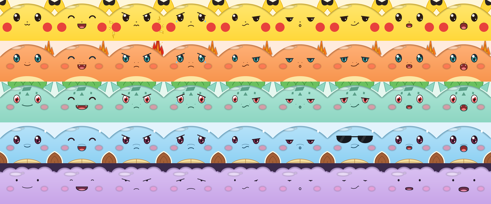

# 功能特性与新增资源

## 功能特性

### 1. 宝可梦脸盘

- 5 个角色：皮卡丘、小火龙、妙蛙种子、杰尼龟、百变怪，加上原版的 Stack-chan 脸，一共 6 种可选。
- 统一的画风：圆顶头型、自上而下的柔和渐变、左上角高光、圆眼睛里两个白色高光、腮红。每只宝可梦再保留自己的标志：

| 角色 | 标志性特征 |
| --- | --- |
| 皮卡丘 | 黑尖耳朵、红脸颊、"ω" 形嘴 |
| 小火龙 | 青绿色瞳孔、奶黄色下巴、上唇上方的小圆点鼻孔、张嘴时的小尖牙、从头后冒出的火尾巴 |
| 妙蛙种子 | 红瞳白眼、额头的多边形斑点、头顶的种子、分得很开的低位小鼻孔、宽嘴和嘴角尖牙 |
| 杰尼龟 | 酒红色眼睛、圆吻部、棕色龟壳和浅色壳缘、分格的奶黄色腹甲 |
| 百变怪 | 豆豆眼、一字长嘴、波浪形头顶 |

- 每个角色的眼睛有 8 种状态（7 种情绪加闭眼），嘴有 9 种状态（7 种情绪加小张嘴、大张嘴）。
- 原版的动画全部保留：眨眼、说话时嘴巴开合、呼吸起伏、待机时张望和小表情、碰头部时开心、晃动时晕眩。

### 2. 特效层

| 角色 | 特效 |
| --- | --- |
| 小火龙 | 火尾巴一直在跳动（4 帧）。生气时换成更高、更红、带火星的火焰（4 帧），而且闪得更快 |
| 皮卡丘 | 生气时两边脸颊放电（3 帧） |
| 杰尼龟 | "酷"表情时戴上墨镜 |

特效层可以放在头部前面，也可以放在头部后面：小火龙的火焰在头后面，所以背景图把头部以外的部分做成了透明。

### 3. 语音换脸、做表情

- `self.robot.set_character`：换脸，选择会保存。
- `self.robot.show_expression`：让模型主动做一个表情并保持几秒。
- 新增"酷 / 得意"情绪（`Emotion::Cool`），也补上了 funny、surprised、thinking 等之前没有对应表情的情绪。

### 4. 情绪带动头部动作

表情变化时，头部舵机会跟着做一个小动作，幅度在 5° 到 16° 之间：

| 情绪 | 头部动作 |
| --- | --- |
| 开心 | 点两下头（服务器几乎每句都发开心，所以只按概率触发，且至少间隔 6 秒） |
| 生气 | 左右甩头，然后低头"瞪人"，保持到情绪结束 |
| 酷 | 抬下巴、侧过脸，保持 |
| 难过、困 | 慢慢低头，保持 |
| 思考（技能进行中） | 抬头看向右上角的技能图标，回答开始时回正 |
| 平静 | 回到动作前的位置 |
| 换脸 | 点一下头 |

- 实现方式：`EmotionMotionModifier`（`firmware/main/stackchan/modifiers/emotion_motion.h`）每帧检查脸上的表情，一变化就播放对应的关键帧。所以服务器下发的情绪、`show_expression`、技能思考，都不用额外接线。
- 只在对话中生效，空闲时头部仍然交给原来的随机张望。机器人被抱起、被摸头，或者有别的动作正在进行时，会自动让出。
- 动作播放的一两秒内，对话期间主循环的额外 100ms 延迟会取消，让舵机动作更平滑。
- 可以用语音关掉：说"别乱动了"，模型会调用 `self.robot.set_head_gestures`。设置保存在 NVS（`avatar`/`gestures`）里，默认打开。

### 5. 技能图标

- 取消了嘴边的文字气泡：原来的字体没有中文字形，中文回复显示成空白。现在说话时只动嘴。激活码这类系统消息仍然用气泡显示。
- 调用工具时，脸切成思考表情，右上角弹出技能图标，开始回答后收起。图标有 7 种：天气、新闻、搜索、Muse、提醒、拍照，以及其他工具共用的星星。

### 6. Muse 桥

- 把 Muse Gadget SDK 的会话代码移植到 ESP-IDF 5.5，和小智运行在同一颗芯片上。
- 3 个 MCP 工具：简报（缓存）、提问（异步，在同一轮对话里念出答案）、取迟到的答案。
- 串口控制台兼容 SDK 的 `chat.py`。详见 [muse.md](muse.md)。

### 7. 异步 MCP 工具（xiaozhi-esp32 补丁）

- 给 `McpServer` 加了 `AddAsyncTool`：工具回调立即返回，结果准备好后再回复给服务器，不会卡住设备主线程。`self.muse.ask` 就是用这个实现的。
- 这部分改动包含在 `firmware/patches/xiaozhi-esp32.patch` 里。

### 8. Mac 端 MCP 服务

免费的天气、网页搜索、新闻搜索，以 launchd 服务的形式开机自启。详见 [mcp-server.md](mcp-server.md)。

### 9. 修复与改进

| 问题 | 处理 |
| --- | --- |
| ESP-IDF 5.5 的硬件 GCM 拒绝空明文的空指针，导致 Noise 握手第 3 条消息失败 | 传一个非空指针 |
| newlib nano 的 printf 不支持 `%lld`，导致崩溃 | 改用 32 位格式 |
| tick 频率是 100 Hz 时 `pdMS_TO_TICKS(2)` 等于 0，Muse 任务空转、触发看门狗 | 至少等待 1 个 tick |
| Muse 占用内部 SRAM，唤醒词任务创建失败 | 大缓冲区挪到 PSRAM，Muse 延后启动 |
| `Avatar` 基类没有虚析构函数，替换脸时旧脸的 LVGL 对象不会被释放 | 加上虚析构函数 |

## 新增资源清单

| 资源 | 位置 | 说明 |
| --- | --- | --- |
| 脸盘素材（5 个角色） | `firmware/main/stackchan/avatar/skins/pokemon/pokemon_assets.c` | 生成器输出的 PNG 嵌入为 C 数组，每个角色约 25 到 30 张图 |
| 特效帧 | 同上（`fx<n>_<情绪>_<帧>`） | 小火龙火焰 8 帧、皮卡丘电光 6 帧、杰尼龟墨镜 1 帧 |
| 技能图标 | 同上（`icon/*`） | 7 个，96×96 像素，带思考泡泡的小尾巴 |
| 素材生成器 | `firmware/tools/pokemon_faces/gen_faces.py` | 用 Pillow 程序化绘制，4 倍超采样 |
| 皮肤代码 | `firmware/main/stackchan/avatar/skins/pokemon/pokemon.{h,cpp}` | `PokemonImages`（PSRAM 解码与图标缓存）、`PokemonAvatar`、`PokemonEye`、`PokemonMouth` |
| 角色与表情 API | `firmware/main/hal/board/avatar_character.h` | `set`、`current`、`names`、`show_expression`、`head_gestures`、`set_head_gestures` |
| 头部动作 | `firmware/main/stackchan/modifiers/emotion_motion.h` | `EmotionMotionModifier`：表情变化时播放头部关键帧 |
| Muse 桥 | `firmware/components/muse_hatch/` | 详见 [muse.md](muse.md) |
| Muse 令牌工具 | `firmware/tools/muse/muse_token.py` | `read` / `send` 两个子命令 |
| MCP 服务 | `mcp-server/` | `server.py`、`mcp_pipe.py`、`install.sh`、launchd 模板 |
| 文档配图 | `docs/pokechan/images/` | 由生成器的输出合成 |

素材总量：152 张 PNG，约 520 KB，编进固件后 app 分区还剩约 16%。素材都是我们自己用代码画的，没有使用任何官方图片或游戏截图；设计时参考了官方图鉴立绘的特征，比如鼻孔的位置和间距、斑点的形状。
