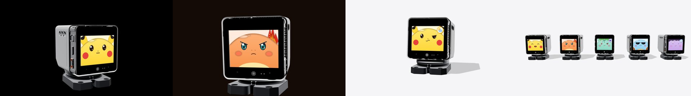

# 宣传素材工具

PokeChan 宣传片、封面和配乐的全部制作脚本。所有画面都是渲染出来的，不是实拍：

- **3D 模型**：官方 StackChan 3D 模型 `app/assets/stack_chan_model.glb`，在浏览器里用 three.js 渲染。
- **屏幕画面**：用固件自己的脸盘生成器（`firmware/tools/pokemon_faces/gen_faces.py`）逐帧绘制。眨眼、说话嘴型、火焰帧率、技能图标的弹出和浮动，都和固件参数一致。
- **头部动作**：和固件里的头部动作一致（`emotion_motion.h`），比如生气甩头、耍酷抬下巴。
- **配乐和音效**：全部用代码合成，是原创内容，没有引用任何现成的曲子或采样。



## 产出

| 文件 | 规格 | 生成脚本 |
| --- | --- | --- |
| `out/pokechan_promo_9x16.mp4` | 1080×1920，30 秒，120 BPM 卡点，带配乐 | `shots_v.py` → 渲染 → `music.py` → `compose_v.py` |
| `out/pokechan_promo_9x16_sfx_only.mp4` | 同上，只有音效（发布时在平台曲库配乐用） | `compose_v.py --no-music` |
| `out/pokechan_promo_16x9.mp4` | 1920×1080，48 秒，带配乐 | `shots_h.py` → 渲染 → `music_h.py` → `compose_h.py` |
| `out/cover_9x16.png` `cover_3x4.png` `cover_1x1.png` | 竖屏大图、小红书 3:4、方块小图 | `cover.py` |
| `out/cover_16x9.png` | 横屏"功能说明"封面 | `cover.py` |

## 准备

```bash
# 1. Python 依赖：沿用脸盘生成器的虚拟环境，再加上自带 ffmpeg 的 imageio-ffmpeg
cd firmware/tools/pokemon_faces
uv venv .venv && uv pip install --python .venv/bin/python pillow numpy imageio-ffmpeg
cd ../../../tools/promo
PY=../../firmware/tools/pokemon_faces/.venv/bin/python

# 2. 字体：Noto Sans SC（SIL Open Font License），只在本地使用，不提交进仓库
mkdir -p fonts
curl -L -o fonts/NotoSansSC.ttf "https://github.com/google/fonts/raw/main/ofl/notosanssc/NotoSansSC%5Bwght%5D.ttf"
```

## 流程

```bash
# 1. 生成镜头：每帧的屏幕画面、舵机角度和机位，输出到 shots/*.json 和 screens/
$PY shots_v.py          # 竖屏 10 个镜头
$PY shots_h.py          # 横屏 11 个镜头
$PY cover.py scene      # 4 张封面的 3D 场景

# 2. 启动本地服务（以仓库根目录为根，渲染页能直接读取官方模型）
python3 serve.py 8765
```

在浏览器打开渲染页，竖屏加 `?w=1080&h=1920`，方图加 `?w=1080&h=1080`，横屏不加参数（默认 1920×1080）：

```
http://localhost:8765/tools/promo/web/render.html?w=1080&h=1920
```

然后在浏览器控制台逐个渲染镜头。每一帧会以 PNG 回传到 `frames/<镜头名>/`：

```js
for (const n of ['v01_hook','v02_switch','v03_angry','v04_sparks','v05_cool','v06_weather',
                 'v07_search','v08_muse','v09_lineup','v10_end']) await renderShot(n);
```

```bash
# 3. 配乐（120 BPM，原创 8-bit 主题 + 电子化混音）
$PY music.py            # 竖屏 30 秒 → out/music_v.wav
$PY music_h.py          # 横屏 48 秒 → out/music_h.wav

# 4. 合成：叠加标题、对白字幕、片尾字卡和音效，再编码成 H.264
$PY compose_v.py
$PY compose_v.py --no-music
$PY compose_h.py
$PY cover.py text
```

`compose.py` 和 `shots.py` 是第一版横屏短片（63 秒，没有配乐）的脚本。竖屏版和横屏版复用了里面的动画、字幕和音效函数。

## 修改指南

- **对白、标题**：竖屏改 `compose_v.py` 里的 `TITLES` / `LABELS` / `SAYS`，横屏改 `compose_h.py` 里的 `TIMELINE`。时间单位是秒，一拍等于 0.5 秒。
- **镜头时长、事件拍点**：竖屏改 `shots_v.py` 的 `LENGTHS`，横屏改 `shots_h.py` 的 `LENGTHS`（单位是拍）。改完后，`music.py` / `music_h.py` 里的段落拍点也要跟着对齐。
- **机位**：用 `cam_keys` 设置关键帧。`az` 是方位角，0 为正面；`el` 是仰角；`dist` 是距离，单位毫米。`shift` 让主体在画面里下移，给标题留位置。
- **字幕安全区**：竖屏版的标题从 y=220 开始；字幕和小字放在 y=1610–1780，避开机器人，同时尽量避开抖音、小红书底部的按钮区。
- **加入真机镜头**：把实拍素材转成同尺寸、30fps 的 PNG 序列，放进 `frames/<新镜头名>/`，再在合成脚本的时间线里插入这个镜头即可。用了实拍镜头后，记得改掉角标里的"3D 渲染演示"。

## 版权说明

- **宣传画面里的宝可梦形象**：是非官方同人绘制，相关权利归任天堂、The Pokémon Company、Game Freak、Creatures 所有。详见仓库根目录的 [DISCLAIMER.md](../../DISCLAIMER.md)。成片和封面上都保留了"非官方同人项目"字样，片尾和封面还保留了完整的免责声明。
- **3D 模型**：官方 StackChan 模型来自上游仓库（M5Stack，MIT）。
- **three.js**：渲染时从 jsDelivr CDN 加载（MIT），不随仓库分发。
- **字体**：Noto Sans SC，SIL Open Font License 1.1，由使用者自行下载，不随仓库分发。
- **ffmpeg**：编码用的 ffmpeg 由 `imageio-ffmpeg` 提供（LGPL/GPL），只作为工具运行，不随仓库分发。
- **配乐和音效**：脚本和它生成的音频都是本项目的原创，随仓库一起以 MIT 授权。Pokémon Game Sound Library 有地区和用途限制，所以没有使用官方音乐。想用宝可梦官方主题曲的话，请发布只带音效的版本，再在平台曲库里选择已授权的曲目。
